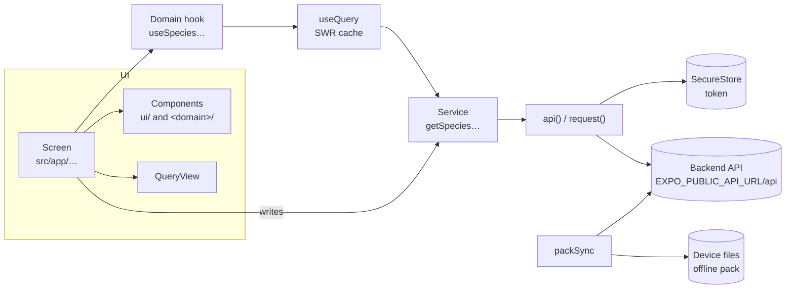

# Architecture

How ZooApp is put together, and why. For setup see the [README](../README.md); for step-by-step recipes see [CONTRIBUTING](../CONTRIBUTING.md).

## Overview

ZooApp is a client for the zoo's REST API. Screens never call the network directly: they use **domain hooks**, which use **services**, which go through a single `api()` function that adds the session token and turns error responses into typed errors.



Key ideas:

- **Thin screens.** A route file composes components and holds screen state. Logic lives in hooks, services and `utils/`.
- **One way to read data.** Every read is an SWR query behind a domain hook, rendered through `QueryView`, so loading, error, offline and empty states look and behave the same everywhere.
- **Offline is a normal state.** Cached data stays on screen when the network drops, and ZooDeck cards can be downloaded ahead of the visit.
- **One design system.** A single color palette, type scale and set of `ui/` components, taken from the design PDFs.

## Folder structure

```
src/
  app/          Routes only. Every file becomes a screen (expo-router).
  components/
    ui/         Design-system components shared by every module
    <domain>/   Components used by one module: map/, tickets/, species/, deck/, duel/, ar/…
  hooks/        Domain data hooks (useSpecies, useTickets…) and UI hooks (useScrolled…)
  services/     api(), token, one module per API domain, swr-config, offline pack
  types/        API types, one file per domain
  utils/        Pure helpers without JSX (format, date, map…)
  theme/        colors.js (the palette) and layout.ts (safe-area/footer spacing)
  contexts/     AuthContext, DuelContext
  global.css    Tailwind layers + typography role classes
assets/
  images/       App images and icons
  models/       3D models (.glb) for AR and the 3D viewer
docs/design/    Design PDFs: design-system.pdf, mobile-app.pdf
```

Never put a non-route file under `src/app/`: expo-router would turn it into a screen.

## Routing and navigation

Routes are files in `src/app/` ([expo-router](https://docs.expo.dev/router/introduction/)). Typed routes are enabled (`experiments.typedRoutes` in `app.json`), so `router.push('/species/12')` is type-checked.

```
src/app/
  _layout.tsx          Root: providers + Stack (no headers, portrait)
  index.tsx            Redirects to /splash
  splash.tsx           Waits for the session check, then /(tabs) or /login
  login.tsx register.tsx forgot-password.tsx
  (tabs)/              Bottom tab bar (custom TabBar)
    index.tsx          Explore
    mizoo.tsx          MiZoo
    zoodeek.tsx        ZooDeck
    panel.tsx          Panel
    ar.tsx             Standalone AR placement screen, not shown in the tab bar
  species/             index, [id]
  tickets/             index → summary → success, my-tickets
  donations/           index → summary → success, history
  deck/                index, [id], map, offline, ar/[id]
  duel/                _layout (DuelProvider), scan → play → review, debug
  points/              season (what the active points season changes)
  map.tsx profile.tsx +not-found.tsx
```

The root layout ([src/app/_layout.tsx](../src/app/_layout.tsx)) keeps the native splash up until the fonts load, then mounts the providers in this order:

```
SafeAreaProvider → KeyboardProvider → DataProvider (SWR) → AuthProvider
   ├─ OfflinePackSync   (background download of the offline card pack)
   ├─ Stack             (all screens)
   └─ OfflineBanner     (shown on top of every screen when offline)
```

**Sessions.** `splash.tsx` uses `useAuth()` to decide between the tabs and `/login`. Screens that need a logged-in user call `useSessionRedirect()`, and write handlers can call `redirectIfSignedOut()` before sending a request (both in [src/hooks/useSessionRedirect.ts](../src/hooks/useSessionRedirect.ts)).

## Data layer

### `api()` and errors

[src/services/api.ts](../src/services/api.ts) is the only place that calls `fetch`, except the avatar upload in `services/profile.ts` (multipart), which throws the same `NetworkError`.

- `request(endpoint, options)` prefixes `EXPO_PUBLIC_API_URL + '/api'`, sets the JSON headers and adds `Authorization: Bearer <token>` from SecureStore.
- `api<T>(endpoint, options)` calls `request` and parses the JSON body. A success with no body (204) resolves to `undefined`.
- Errors are typed:
  - `NetworkError`: the request never reached the server (`isNetworkError(e)` tells them apart). Nothing else counts as offline: a `TypeError` from the app's own code is a bug, not a lost connection.
  - `ApiValidationError` (422): `errors` holds per-field messages, ready for `TextField`'s `error` prop.
  - `ApiError`: any other failed response, with `status` and optional `data`. A body that isn't JSON (an HTML error page, a truncated response) is an `ApiError` with the response's status.

The token lives in [src/services/token.ts](../src/services/token.ts), separate from `auth.ts` to avoid a circular import.

### Services

One file per API domain in `src/services/` (`species.ts`, `tickets.ts`, `donations.ts`, `cards.ts`, `duels.ts`…). Each exports:

- a `<domain>Keys` object: the endpoint paths, which double as SWR cache keys;
- plain async functions that call `api()` and unwrap the response envelope into the types from `src/types/<domain>.ts`.

```ts
export const speciesKeys = {
	list: '/species',
	detail: (id: string | number) => `/species/${id}`,
}

export async function getSpecies(): Promise<Species[]> {
	const response = await api<SpeciesListResponse>(speciesKeys.list)
	return response.data.species || []
}
```

### Reads: hooks + SWR

[src/hooks/useQuery.ts](../src/hooks/useQuery.ts) wraps SWR and returns a small `QueryResult<T>` (`data`, `error`, `isLoading`, `refresh`). Domain hooks are one-liners on top of it:

```ts
export function useSpecies() {
	return useQuery(speciesKeys.list, getSpecies)
}
```

Only `src/hooks/**` and `src/services/swr-config.tsx` may import `swr` (enforced by ESLint), so swapping or tuning the cache library touches a handful of files.

[src/services/swr-config.tsx](../src/services/swr-config.tsx) adapts SWR to React Native:

- focus revalidation comes from `AppState` (returning to the app), not browser focus;
- reconnect revalidation comes from NetInfo;
- requests aren't retried while offline; a failed revalidation keeps the cached data on screen;
- it uses its own cache provider, so the global `mutate` from `swr` does **not** reach it. Use `useDataRefresh()` instead.

### Rendering a query: `QueryView`

[src/components/ui/QueryView.tsx](../src/components/ui/QueryView.tsx) takes a `QueryResult` and renders `LoadingState`, `ErrorState` (with retry, or an offline message) or `EmptyState`, and only calls its `children(data)` when there is data. Loading and error are shown only when there is no cached data, so a failed refresh doesn't blank the screen.

### Writes

Writes are plain async service functions (e.g. `createDonation` in `services/donations.ts`) called from a screen handler. The pattern, as in `src/app/donations/summary.tsx`:

1. `if (await checkOffline())` → `notifyOffline(message)` and stop. If the write needs a session, `if (await redirectIfSignedOut()) return`.
2. Call the service function.
3. On success, refresh affected reads with [`useDataRefresh()`](../src/hooks/useDataRefresh.ts) (`refreshMyTickets`, `refreshDonations`, `refreshCards`, `refreshProfile`…).
4. On error: `isNetworkError` → `notifyOffline`; `ApiValidationError` → field errors; anything else → `Toast` with a title and message.

## State

There is no global store. State lives in three places:

| Kind                | Where                                                                                                                                                                                                         |
| ------------------- | ------------------------------------------------------------------------------------------------------------------------------------------------------------------------------------------------------------- |
| Server data         | SWR cache, through domain hooks                                                                                                                                                                               |
| Session             | `AuthContext` ([src/contexts/AuthContext.tsx](../src/contexts/AuthContext.tsx)): `user`, `isAuthenticated`, `login`, `register`, `logout`, `refreshUser`. The user itself is an SWR query (`useCurrentUser`). |
| A multi-screen flow | A context scoped to that flow's layout, e.g. `DuelContext`, provided by `src/app/duel/_layout.tsx` for scan → play → review                                                                                   |
| Screen UI           | `useState` in the screen                                                                                                                                                                                      |

On logout, `useDataRefresh().clearCache()` drops every cached response so nothing leaks into the next account, even if deleting the cards fails, and the user's decrypted cards are deleted. When an account signs in, any other account's decrypted cards still on the phone (a delete that failed at logout) are deleted too.

## Offline support

- **Detection**: [src/hooks/useNetworkStatus.ts](../src/hooks/useNetworkStatus.ts) (`useNetworkStatus`, `checkOffline`, `isOfflineState`, `isCellularState`) on top of NetInfo.
- **Feedback**: `OfflineBanner` is mounted once in the root layout. Any code can call `notifyOffline(message?)` ([src/services/offline-notice.ts](../src/services/offline-notice.ts)) to explain why an action didn't happen.
- **Cached reads**: SWR keeps the last data in memory and revalidates on reconnect.
- **Offline card pack** (ZooDeck): the zoo may have poor coverage, so the cards' 3D models and images can be downloaded ahead of the visit.
  - [`packSync.ts`](../src/services/packSync.ts) downloads the encrypted catalog file by file (resumable, respecting cellular settings), then decrypts the files of the cards the user owns.
  - [`packStore.ts`](../src/services/packStore.ts) defines the on-device layout in the documents directory: shared encrypted `packs/{id}.bin` files and per-user decrypted copies in `cards/{userId}/`.
  - [`packCrypto.ts`](../src/services/packCrypto.ts) verifies and decrypts AES-GCM `.bin` files.
  - Screens read progress through `usePackStatus()`; `OfflinePackSync` in the root layout runs the sync, and `deck/offline.tsx` shows its state.

## Points

Points are authoritative on the server. Each action that gives points (a duel win, a ticket order, a donation) awards them in its own request and returns the same `data.points` block (`PointsAward` in [`types/points.ts`](../src/types/points.ts)): `awarded`, `total`, `level`, `level_up` and the visible `season`. The app never adds points itself; after the action it revalidates the profile (`refreshProfile()`), so the header and MiZoo show the new total.

- **Duel win**: `DuelPoints` in the victory dialog.
- **Ticket order and donation**: [`PointsEarnedCard`](../src/components/points/PointsEarnedCard.tsx) under the success banner: the points counted up (`usePointsReveal`, shared with the duel), the total, the progress to the next level once the refreshed profile reports the new total, and a level-up badge. At 0 points there's no card, never "+0".
- **Season notice**: `SeasonPointsNotice` explains what the season changed for that action ("Esta compra da 20 puntos en lugar de 10"). When `base_points` is `null` (rule off, donation under the server's minimum) it doesn't compare, so the season isn't blamed.

### Points seasons

The server can run one **points mode** at a time (a season or event) that changes what each point rule gives. When the zoo makes it visible, `GET /api/points/season` returns its notice; otherwise `null`. The app only explains it: points are always the ones the server returns with each action.

- **Data**: [`services/points.ts`](../src/services/points.ts) + `usePointSeason()`; revalidated when the app returns to the foreground and on pull-to-refresh, never polled.
- **Banner**: [`SeasonBanner`](../src/components/points/SeasonBanner.tsx) on Explore, MiZoo and ZooDeck, opening `points/season`. Closing it hides it on all three (`useSeasonDismissal`, stored with the hints in SecureStore) until a season with another title arrives. MiZoo's `LevelCard` keeps a `SeasonChip` so the details stay reachable, and closing it on Explore or ZooDeck shows `SeasonDismissedToast` to point there.
- **Actions**: with `data.points.season`, the duel win and the ticket and donation success screens show `SeasonPointsNotice` (see above).
- **Icon and color**: the server sends a catalog key and four hex tones. [`utils/pointSeason.ts`](../src/utils/pointSeason.ts) maps the key to a Hugeicons icon (unknown keys → `SparklesIcon`) and falls back to the brand tones when `color` is `null`. The tones are runtime values, so they go in `style`: `text` on `soft`, `on_accent` on `accent`.

## Styling and design system

- **Source of truth**: the PDFs in [docs/design/](design/). `design-system.pdf` defines tokens and components; `mobile-app.pdf` has every screen (codes A-01…A-44, designed at 390×844).
- **NativeWind**: styling is Tailwind classes in `className`. `StyleSheet.create` is banned by lint; inline `style` is only for animated or runtime-computed values.
- **Palette**: [src/theme/colors.js](../src/theme/colors.js) is the single source of colors. Tailwind reads it (`bg-esmeralda`, `text-tinta-2`…) and TS imports it (`colors.lima`). Hex literals elsewhere are lint errors.
- **Typography**: role classes in [src/global.css](../src/global.css) (`text-h1`, `text-body`, `text-meta`…) and family classes (`font-display`, `font-sans-bold`…). Fonts: Barlow (display) and Noto Sans (text). Weight utilities like `font-bold` are not used, because on Android a custom font's weight comes from its family name.
- **Layout helpers**: [src/theme/layout.ts](../src/theme/layout.ts) computes bottom spacing from the safe-area insets (`useFixedFooterSpace`, `useScrollBottomSpace`, tab bar padding), since the Android navigation bar height varies.
- **Components**: `src/components/ui/` holds the design-system components (Button, Card, ListCard, TextField, Chip, Badge, Modal, BottomSheet, Toast, QueryView, ScreenBackground, TopBar…). Module-specific pieces go in `src/components/<domain>/`.

## Maps

The zoo map uses MapLibre (`@maplibre/maplibre-react-native`). Screens: `src/app/map.tsx` (visitor map) and `src/app/deck/map.tsx` (ZooDeck map with duel locations). Layers and markers are in `src/components/map/`, camera logic in `useMapCamera`, data in `services/map.ts` + `useMapData` / `useZooDeckMap`, location in `useUserLocation`.

## AR and 3D

- **Library**: ViroReact (`@reactvision/react-viro`), configured through its config plugin in `app.json` (`xRMode: ["AR"]`). It needs a development build and a phone with ARCore.
- **Where**: the card AR screen is `src/app/deck/ar/[id].tsx`; scenes and camera UI live in `src/components/ar/` (`ModelPlacementScene`, `Viewer360Scene`, `ArCameraControls`…). The card 3D viewer is in `src/components/deck/CardViewerScene.tsx`.
- **Fallback**: [`useArAvailability`](../src/hooks/useArAvailability.ts) returns `'ar'`, `'unsupported'`, `'no-camera'` or `'forced'`; anything but `'ar'` shows the 360° view instead.
- **360° view** (`Viewer360` + `Viewer360Scene`, used by the card AR screen and the duel): the animal stands in a savanna scenario (`assets/models/scenario/savanna.glb`, with `assets/images/view360/savanna-sky.jpg` as the sky). The scenario is laid out around −Z, where the animal stands: a clear area 6 m wide from 1.5 to 8.5 m, framed by plants and rocks. Its ground has the sun's shadows baked into its texture, so only the animal casts a live shadow: the scenario and helper quads set `shadowCastingBitMask` to 0, and the sun's shadow box follows the animal. With `shadowsEnabled`, every start of the GVR view shows only the ground for about a second before head tracking begins. GVR's head tracking sometimes starts very late or never; until it does, the camera sits at a fixed default pose looking straight down, so the screen shows one solid colour. The scene spots that exact pose (`isUntrackedPose`), and if it lasts 3 seconds after the models load, `Viewer360` creates the view again (unmount, release, remount, at most twice). The scenario, the sky (`Viro360Image` rotation) and the directional light all turn with the animal's heading: when it's first placed and on every recenter. The sun's direction is turned in code (`rotateAroundY` in [`utils/view360.ts`](../src/utils/view360.ts)). A plain ground disc stands in while the scenario loads or if it fails. The scenario is built and baked in Blender outside the repo; changing it means re-exporting it from there.
- **Selfie** (A-30): [`src/app/deck/selfie/[id].tsx`](../src/app/deck/selfie/[id].tsx) runs ARCore on the front camera (`frontCameraEnabled` on `ViroARSceneNavigator`) with `SelfieScene`. The front camera has no plane tracking, so the animal stands at a fixed spot in front of where the session started, and [`useModelGestures`](../src/hooks/useModelGestures.ts) moves, resizes and turns it from a touch layer above the view. It needs ARCore like the AR view: on a phone without it the card's Selfie button looks disabled and a tap shows a toast explaining why (the selfie screen itself shows a notice instead of a 360° view). The front-camera session runs at about 20 fps, so the animal starts still and a tap animates it. `ViroCameraTexture` (a camera feed inside a 3D scene) isn't used: no ViroReact release ships its Android native code, and it crashes.
- **Photos** (A-29 → A-32): both shutters call the AR navigator's `_takeScreenshot`, which captures the camera and the animal without the controls. `PhotoReview` shows the shot in `PhotoFrame` (the animal's name, the zoo and its logo); keeping it captures the frame with `react-native-view-shot` as the final JPEG. [`src/app/deck/photo.tsx`](../src/app/deck/photo.tsx) saves it to the gallery (`expo-media-library`, write-only access) or opens the share menu (`expo-sharing`). [`services/photo.ts`](../src/services/photo.ts) keeps every shot in `cache/photos/` and clears it when the flow ends; nothing is uploaded.
- **Scene rules**: Viro components are not React Native views (no `className`, no layout props). Scene components are defined at module level and receive data through `viroAppProps`. UI over the camera is a normal React Native layer positioned above the navigator.
- **Gestures**: outside rear-camera plane AR, Viro's views don't handle touches, so drags go through a `PanResponder` layer above them (`CardViewerFrame`, `Viewer360`, `useModelGestures`). PanResponder reuses its `gestureState` object: copy `dx`/`dy` and the touches when the event arrives, before using them in a state updater.
- **Models**: `.glb` files in `assets/models/` (bundled) or from the offline pack (downloaded). `metro.config.js` registers the 3D extensions as assets and `src/assets.d.ts` types the imports.

## Native configuration and builds

Native code is generated by `npx expo prebuild` from `app.json` and its config plugins (expo-router, splash screen, ViroReact, camera, secure store, date picker, MapLibre, image, web browser, sharing). Treat `android/` and `ios/` as generated output.

A native rebuild (`npx expo run:android`) is needed after adding or upgrading a package with native code, or after changing `app.json` plugins or native settings. Everything else hot-reloads through Metro.

## Tooling

- **TypeScript** strict, `@/` alias for `src/`.
- **ESLint** (`eslint-config-expo` + project rules): bans `StyleSheet.create`, hex colors outside the palette, and `swr` imports outside hooks.
- **Prettier** with `prettier-plugin-tailwindcss`: tabs, single quotes, no semicolons, sorted classes.
- **React Compiler** is enabled (`experiments.reactCompiler`), so manual `useMemo`/`useCallback` are rarely needed for performance.
